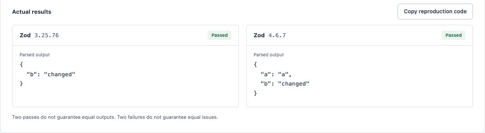

# Launch material — unpublished

Status checked on 2026-11-13: [source repository](https://github.com/FightJs/zod-upgrade-gotchas) is public; the [HTTPS demo](https://fightjs.github.io/zod-upgrade-gotchas/#case=default-partial) is live and has passed browser acceptance. The application now has an MIT license, selected with publisher authorization. All text below is an **AI-assisted draft for publisher review**, not a published post. The repository includes LICENSE and preserves third-party notices.

Use one Chinese technical article and one English short post, both with `docs/images/default-partial-results.png`. It is a crop of the existing genuine screenshot, not a generated demonstration. Full capture: `docs/images/default-partial.png`.

The drafts link to the verified demo and real source repository. Deployment and draft preparation do not mean a community post was published. Posting remains pending the exact platform/account targets and applicable rule checks.

## 中文技术文章草稿

### Zod 升级后，两边校验都通过，输出却不同

同一份输入 `{"b":"changed"}`，在下面两个真实发行版本中都通过校验，但解析结果不同：

```text
Zod 3.25.76 → {"b":"changed"}
Zod 4.6.7   → {"a":"a","b":"changed"}
```



区别出现在带默认值的对象上再调用 `.partial()`。这次使用的 schema 是：

```js
z.object({
  a: z.string().default('a'),
  b: z.string().default('b')
}).partial()
```

对这份输入，v3 保留了 `a` 的缺省状态；v4 在 `.partial()` 内也应用默认值，补出 `a: "a"`。所以升级时只看 `safeParse().success`，可能会漏掉解析后数据的变化。

这与 PATCH 接口尤其相关：如果更新逻辑直接把解析结果交给数据库，v4 解析出来的额外字段可能参与写入。但它是否影响你的接口，还取决于 schema、更新代码以及业务对缺省字段的约定，不能仅凭这个例子认定项目有问题。

#### 最小复现

分别安装两个精确的真实发行包，而不是使用同一个 v4 包的 `/v3` 入口：

```sh
npm install zod-v3@npm:zod@3.25.76 zod-v4@npm:zod@4.6.7
```

把下面代码保存为 `repro.mjs`，运行 `node repro.mjs`：

```js
import * as v3 from 'zod-v3';
import * as v4 from 'zod-v4';

const makeSchema = (z) => z.object({
  a: z.string().default('a'),
  b: z.string().default('b')
}).partial();
const input = { b: 'changed' };

for (const [version, z] of [['3.25.76', v3], ['4.6.7', v4]]) {
  const result = makeSchema(z).safeParse(structuredClone(input));
  console.log(version, JSON.stringify(result));
}
```

再把输入改为 `{ a: 'x', b: 'y' }`，两边都会通过，并返回相同的字段和值。这条对照说明差异与输入有关，不是“升级后输出必然不同”。

#### 在浏览器里对照

Zod Upgrade Gotchas 把这个例子和另外两个边界变化放在一页：可以选择案例、编辑 JSON、运行两版、恢复默认、复制完整复现代码。分享链接只包含固定案例 ID，打开后运行默认输入，不携带你的修改。

**[在线体验这个案例](https://fightjs.github.io/zod-upgrade-gotchas/#case=default-partial)**，无需注册或安装。也可以从[源码仓库](https://github.com/FightJs/zod-upgrade-gotchas)取回工程，运行 `npm ci`、`npm run dev` 本地体验。页面的实际结果由两个包计算，不是预设的演示答案。

这只是三个固定行为的参考，不会扫描你的项目，也不会自动迁移代码。升级时除了关注校验能否通过，还应检查解析结果是否保持了业务所需的字段语义。

参考：[Zod #6627：Default with partial in zod 4](https://github.com/colinhacks/zod/issues/6627)、[官方迁移指南](https://zod.dev/v4/changelog)。

## English short post draft

The following single post is under 280 characters, including its literal repository URL. Attach the same cropped screenshot; no thread or mass mentions are needed.

<!-- english-post:start -->
Zod 3.25.76 → 4.6.7: both pass, different output.
With .default() + .partial(), {"b":"changed"} gains "a":"a" in v4.
Try: https://fightjs.github.io/zod-upgrade-gotchas/#case=default-partial
Source: https://github.com/FightJs/zod-upgrade-gotchas
<!-- english-post:end -->

Image alt text: “Input: {b: 'changed'}. Zod 3.25.76 and 4.6.7 both pass. v3 returns only b; v4 also returns a: 'a'.”

## Channel and rule boundary

- Chinese: prepare for the publisher's familiar technical blog/community; the exact platform/account is not selected. Check that platform's current AI-assisted content, attribution and self-promotion rules before using this draft, and disclose assistance where required. A Chinese community's permission has **not** been established by this preparation.
- English: one existing X or Bluesky account, subject to the publisher selecting it and checking the applicable current rules. Bluesky's official guidelines returned HTTP 403 to the read-only request in this preparation; their contents were **not** verified. No claim of platform approval is made.
- **Do not use either draft on Hacker News.** Its current [guidelines](https://news.ycombinator.com/newsguidelines.html), fetched on 2026-11-13, say “Don't post generated text or AI-edited text” and “Don't solicit upvotes, comments, or submissions.” The publisher would need to write independently, not reword this draft. HN is outside this first round.
- Reddit/r/typescript is outside this first round: current subreddit rules have not been rechecked here. Do not cross-post this material there.
- No bulk posting, mass tagging, paid stars, reciprocal votes, issue spam, unsolicited contacts or directory submissions. A draft is not authorization to publish.

## Authorization and pending publishing targets

On 2026-11-13 the publisher authorized license selection, remote push, GitHub Pages setup/deployment and posting. MIT was selected for the application. No repeated permission is required for those actions.

The Chinese and English platforms/accounts have not yet been specified. Posting awaits those targets and their applicable rule checks; platform restrictions still apply. No post has been published.
