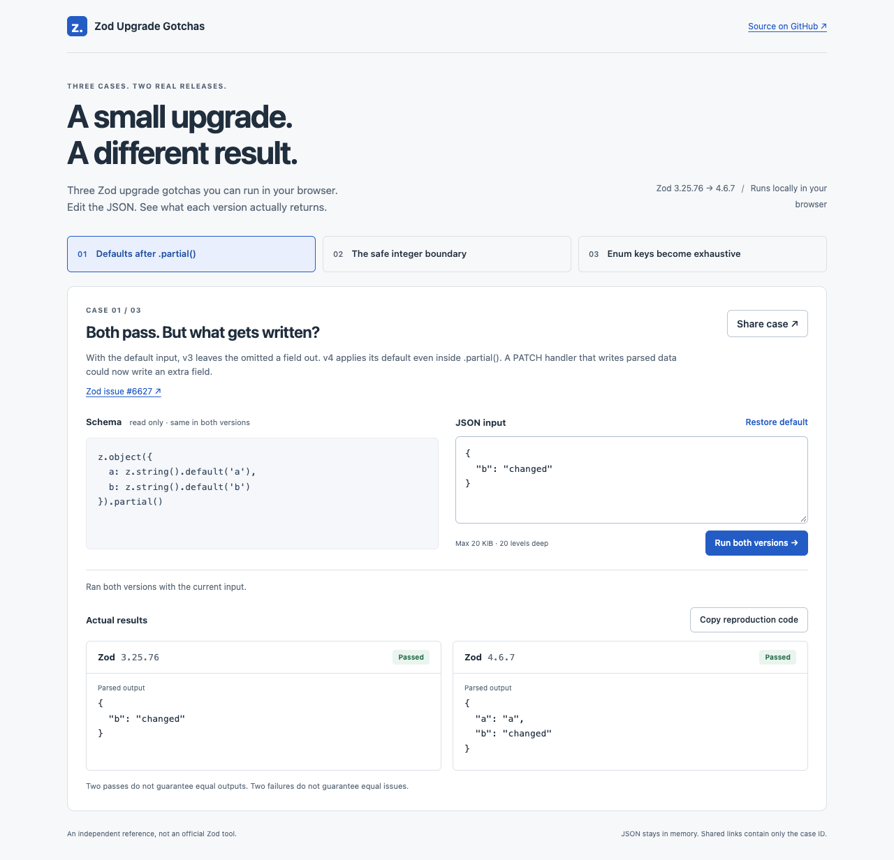

# Zod Upgrade Gotchas

Compare three real Zod 3 → 4 behavior changes in your browser before relying on parsed data.

A small, independent reference: choose one of three fixed schemas, edit JSON, and compare real results from **Zod 3.25.76** and **Zod 4.6.7**. Both passing validation does not mean both returning the same data.

**Source:** [FightJs/zod-upgrade-gotchas](https://github.com/FightJs/zod-upgrade-gotchas). **Online demo:** not deployed; no live demo URL is available.

## Real result



Captured from the local production preview on 2026-11-13 with the default input, using the installed packages. Both badges say Passed, while the parsed outputs differ. This is an actual browser screenshot, not a mockup.

## Run locally

Use Node.js 22 LTS and npm. This acceptance run used Node 20.13.0 and npm 10.8.0; `npm ci`, all 9 tests, TypeScript, and the production build passed in that environment.

```sh
git clone https://github.com/FightJs/zod-upgrade-gotchas.git
cd zod-upgrade-gotchas
npm ci
npm run dev
```

Open the local URL printed by Vite (normally http://127.0.0.1:5173).

```sh
npm test          # Real packages, runner, boundaries, exceptions, executable copied snippets
npm run check    # TypeScript, including tests
npm run build    # Static output in dist/
npm run preview  # Production preview, normally http://127.0.0.1:4173
```

## Quick reference

These are observed default results, not simulated fixtures in the webpage. Both versions construct their own schema and receive independent input copies on every run.

| Case / fixed fragment | Input | Zod 3.25.76 | Zod 4.6.7 |
| --- | --- | --- | --- |
| Defaults + partial | `{"b":"changed"}` | Pass → `{"b":"changed"}` | Pass → `{"a":"a","b":"changed"}` |
| Integer range | `9007199254740992` | Pass → `9007199254740992` | Fail → `too_big`, maximum `9007199254740991` |
| Enum-key record | `{"a":1}` | Pass → `{"a":1}` | Fail → `invalid_type` at `["b"]`, expected `number` |

To open a fixed case, append `#case=default-partial`, `#case=integer-range`, or `#case=enum-record` to the running app URL.

### 1. Defaults inside a partial object

```js
z.object({
  a: z.string().default('a'),
  b: z.string().default('b')
}).partial()
```

In v4, the omitted `a` receives its default even inside `.partial()`. A PATCH handler that writes parsed data could write an additional field. Explicit input `{"a":"x","b":"y"}` produces the same output in both versions.

Source: [Zod issue #6627](https://github.com/colinhacks/zod/issues/6627).

### 2. Safe integer range

```js
z.number().int()
```

v4 requires safe integers. `9007199254740992` is an integer but exceeds `Number.MAX_SAFE_INTEGER`; it passes v3 and fails v4. Input `42` passes both with output `42`. JavaScript JSON numbers already use IEEE-754: arbitrary large decimal integers are not losslessly preserved.

Source: [Official migration guide: numbers](https://zod.dev/v4/changelog#znumber).

### 3. Exhaustive enum keys

```js
z.record(z.enum(['a', 'b']), z.number())
```

v4 requires both enum keys. Missing `b` fails; input `{"a":1,"b":2}` passes both. The page shows each version's original issues without normalizing error codes or messages.

Source: [Official migration guide: records](https://zod.dev/v4/changelog#zrecord).

## Behavior and limits

- Initial load, case selection, and Restore default run automatically. Editing clears previous results and disables copying until valid input is run again.
- Copy reproduction code includes the actual last-run input, exact npm alias installation instructions, both factories, and a `node repro.mjs` command. The generated snippets are executed in automated tests.
- Share case copies only the fixed case ID in a URL fragment. It never encodes edited input or results. Opening/reloading the link runs that case's default input. Unknown IDs fall back to the first case with a notice.
- Clipboard failure reveals a focused, selected, read-only textarea for manual copying. Clipboard APIs normally require HTTPS or localhost.
- Only JSON is editable. Input must be at most 20 KiB in UTF-8, with at most 20 nested object/array containers; the outermost container counts as one. Non-finite parsed numbers such as `1e400` are rejected to keep copied reproductions faithful.
- Invalid JSON and limit violations do not run Zod. Execution exceptions are shown as **Incomplete**, independently for each side. They never imply equal results.
- Inputs and results use text rendering. Nothing is uploaded or persisted. No external fonts, analytics, arbitrary JS execution, backend, or version switching.
- These three examples do not check your project's compatibility, establish that Zod has a bug, or predict business impact for all inputs.

Two separate published packages are pinned via npm aliases, not the `/v3` entry point of a v4 package. `package-lock.json` locks the install. The app is Vite + TypeScript + native DOM/CSS, with no runtime UI framework or diff library.

## Browser verification

The production build was exercised in Chromium at desktop, 375px, and 320px widths on 2026-11-13. See [VERIFICATION.md](VERIFICATION.md) for outcomes and gaps. The release screenshot above is included in `docs/images/`; additional local screenshots and the latest browser log are under `output/playwright/` (ignored by Git).

To repeat the browser assertions, start `npm run preview` on port 4173 in another terminal, then use the Playwright CLI (a test-only tool, not an app dependency):

```sh
mkdir -p output/playwright
npx --yes --package @playwright/cli playwright-cli -s=zod open http://127.0.0.1:4173/
npx --yes --package @playwright/cli playwright-cli -s=zod run-code "$(cat tests/browser-check.js)"
```

A compatible Chromium/Chrome installation is required. Browser tests use real clipboard permissions for the success path and deliberately reject clipboard writes for the fallback path.

## Static publication

Serve `dist/` from any static host after `npm run build`. Relative asset URLs support a subdirectory. Hash-based case links need no server rewrite rules. No public deployment has been tested in this acceptance run.

English and Chinese first-post copy is in [LAUNCH.md](LAUNCH.md). The source link is real; the public demo is explicitly marked as not deployed.

The page's source link defaults to this repository. `VITE_SOURCE_URL` can override it at build time. No deployment, GitHub Pages setup, or hosting connection is included.

## License status

This project has **no project license**. Making the repository public does not grant an open-source license or general permission to use, modify, or redistribute the project. No MIT or other project license has been assigned.

Third-party dependencies retain their own licenses and copyrights. [THIRD_PARTY_NOTICES.md](THIRD_PARTY_NOTICES.md) preserves the license and copyright notice for the two Zod runtime packages; that notice applies to Zod, not to this application.

## Contributing verified cases

Propose a case with its official source or issue, exact package versions, minimal schema, JSON input, observed outputs/issues, and an equal-result control. Verify behavior before changing explanations. Prefer a small, evidenced case over new platform features.
