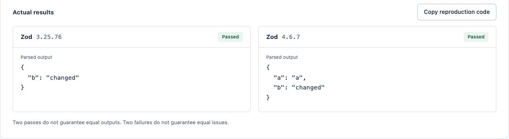

# Zod 3 升 4 实测：校验都通过，解析结果多出字段——PATCH 迁移与回归测试

一次依赖升级，如果旧版和新版的 `safeParse().success` 都是 `true`，你会认为接口行为没变吗？

下面这个例子值得多看一眼：**请求里没有 `a`，两版校验都通过，但新版解析结果里出现了 `a`。** 如果 PATCH 接口直接把解析结果作为更新数据，原本“没传就不更新”的约定就可能被改变。

**项目源码（MIT）：[github.com/FightJs/zod-upgrade-gotchas](https://github.com/FightJs/zod-upgrade-gotchas)** · [在线运行三个真实案例](https://fightjs.github.io/zod-upgrade-gotchas/#case=default-partial)

如果这个对照能帮你检查下次 Zod 升级，欢迎在 GitHub 点个 **Star**，方便以后找到。体验和复现代码始终开放，不设 Star 门槛。

> 创作说明：本文使用 AI 辅助撰写。代码与对照结果已在两个真实发行包上执行验证，截图来自真实页面；PATCH 数据更新是用于说明影响的模拟场景，不是虚构的线上事故。

## 先看结果：成功不等于行为相同

同一份 JSON 输入：

```json
{"b":"changed"}
```

使用相同的 schema：

```js
z.object({
  a: z.string().default('a'),
  b: z.string().default('b')
}).partial()
```

实际结果：

| 真实发行版本 | 校验 | 解析后的 data |
| --- | --- | --- |
| Zod 3.25.76 | 通过 | `{"b":"changed"}` |
| Zod 4.6.7 | 通过 | `{"a":"a","b":"changed"}` |



**[打开在线例子，直接修改 JSON 运行](https://fightjs.github.io/zod-upgrade-gotchas/#case=default-partial)**。不需要安装依赖、注册或填写 key。把输入换成 `{"a":"x","b":"y"}`，你又会得到两版相同的输出。

这是一条很容易漏掉的升级检查项：**不仅要测试“能不能通过”，还要测试“通过后产生了什么数据”。** 本文的结论只针对列出的版本、schema 和输入，不推断所有 Zod 3/4 版本都有完全相同的表现。

## 1. 为什么 .partial() 后还会补出默认值？

这里叠加了两种语义：

- `.partial()` 让对象的字段可以缺省。
- `.default()` 定义字段缺省时要使用的默认值。

对本文这个组合，v3 没有把缺省的 `a` 放进解析结果；v4 则会在可选字段内部应用默认值。这是版本行为变化，不应直接称为漏洞，也不代表业务一定出错。

容易混淆的是“允许不传”和“解析时不产生字段”。这两句话描述的不是同一层行为。Zod 不只是校验输入，它还可能通过默认值等机制生成解析后的数据。

官方迁移指南也说明了这一变化，参见 [Defaults applied within optional fields](https://zod.dev/v4/changelog#defaults-applied-within-optional-fields)。对应的使用场景可参考 [Zod #6627](https://github.com/colinhacks/zod/issues/6627)。

## 2. 用两个真实发行包复现

建议使用 Node.js 22，在一个临时目录安装精确版本：

```sh
mkdir zod-partial-repro
cd zod-partial-repro
npm init -y
npm install zod-v3@npm:zod@3.25.76 zod-v4@npm:zod@4.6.7
```

这里的 `zod-v3` 和 `zod-v4` 是 npm 包别名，分别对应两个真实发行包。没有使用同一个 v4 包的 `/v3` 子入口冒充历史版本。

将下面代码保存为 `repro.mjs`，执行 `node repro.mjs`：

```js
import * as v3 from 'zod-v3';
import * as v4 from 'zod-v4';

const makeSchema = (z) => z.object({
  a: z.string().default('a'),
  b: z.string().default('b')
}).partial();

const input = { b: 'changed' };
const current = { a: 'keep-a', b: 'keep-b' };

for (const [version, z] of [['3.25.76', v3], ['4.6.7', v4]]) {
  const result = makeSchema(z).safeParse(structuredClone(input));
  console.log(version, JSON.stringify(result));
  if (result.success) {
    // 仅模拟“把解析结果作为更新字段”的业务写法，不连接数据库。
    console.log('next', JSON.stringify({ ...current, ...result.data }));
  }
}
```

输出中的关键信息是：

```text
3.25.76 {"success":true,"data":{"b":"changed"}}
next {"a":"keep-a","b":"changed"}
4.6.7 {"success":true,"data":{"a":"a","b":"changed"}}
next {"a":"a","b":"changed"}
```

差别因此进入了业务层：同一个“只更新 b”的请求，在第二种解析结果下，还可能把已有的 `a: "keep-a"` 覆盖成默认值。

注意条件：只有更新逻辑采用了这类“直接写入解析结果”的策略时，这个模拟才与业务相关。真实 ORM、字段映射、事务和更新策略仍需独立审查；这里没有证明某个数据库已经被错误更新。

## 3. 先决定业务语义，再调整 schema

不要看到差异就机械地删除所有 `.default()`。创建接口和局部更新接口通常有不同的需求：

| 操作 | 缺省字段的常见约定 | 可考虑的 schema 策略 |
| --- | --- | --- |
| 创建资源 | 可以使用系统默认值 | 创建 schema 保留 `.default()` |
| PATCH 更新 | 未提供的字段保持原值 | 单独定义无默认值的 partial schema |
| 显式重置 | 用户明确要求恢复默认或清空 | 设计明确的输入约定，并单独验证 |

如果业务确实规定“未提供就不更新”，可以这样分开定义，而不是直接对带默认值的创建 schema 调用 `.partial()`：

```js
// z 是你当前使用版本的 Zod 模块。
const createSchema = z.object({
  a: z.string().default('a'),
  b: z.string().default('b')
});

const patchSchema = z.object({
  a: z.string(),
  b: z.string()
}).partial();
```

在锁定的这两个版本中，`patchSchema.parse({ b: 'changed' })` 都返回 `{"b":"changed"}`。这项调整只适用于“省略即保持原值”的业务约定，不是通用的 Zod 升级修复器。

尤其不要把 `null` 当成“没有提供”。本文字段是字符串，所以显式传 `null` 会失败。如果接口支持清空字段，应通过 schema 和更新代码明确处理；不要依赖默认值推测用户意图。

## 4. 把这个发现变成可运行的业务回归测试

一个有用的迁移测试，不是只断言成功，也不是把所有响应快照无差别更新。它应当守住实际业务约定。

在同一目录保存为 `patch-check.mjs`，运行 `node patch-check.mjs`：

```js
import assert from 'node:assert/strict';
import * as v3 from 'zod-v3';
import * as v4 from 'zod-v4';

for (const [version, z] of [['3.25.76', v3], ['4.6.7', v4]]) {
  const patch = z.object({ a: z.string(), b: z.string() }).partial();
  const current = { a: 'keep-a', b: 'keep-b' };

  // 省略 a：更新后的 a 仍然是业务中的原值。
  const parsed = patch.parse({ b: 'changed' });
  assert.deepEqual(parsed, { b: 'changed' });
  assert.deepEqual({ ...current, ...parsed }, {
    a: 'keep-a', b: 'changed'
  });

  // 空 PATCH 的解析结果不产生默认更新字段。
  assert.deepEqual(patch.parse({}), {});

  // 显式提供字段时，保留用户提供的合法值。
  assert.deepEqual(patch.parse({ a: 'new-a', b: 'changed' }), {
    a: 'new-a', b: 'changed'
  });

  // null 与类型错误必须由 schema 拦住。
  assert.equal(patch.safeParse({ a: null }).success, false);
  assert.equal(patch.safeParse({ a: 123 }).success, false);
  console.log(version, 'PATCH checks passed');
}
```

本文已实际执行这段代码，两版均通过。例子里的对象合并用于验证字段语义，不是生产数据库更新函数；空 PATCH 是否应被 API 拒绝，也应按业务规则决定。

对原来的带默认值 schema，还可以保留下面这张小矩阵作为升级审查依据：

| 输入 | Zod 3.25.76 输出 | Zod 4.6.7 输出 | 观察点 |
| --- | --- | --- | --- |
| `{}` | `{}` | `{"a":"a","b":"b"}` | 缺省字段是否变成写入字段 |
| `{"b":"changed"}` | `{"b":"changed"}` | `{"a":"a","b":"changed"}` | 只改 b 时是否额外出现 a |
| `{"a":"x","b":"y"}` | 原样返回这两个字段和值 | 相同 | 明确提供完整输入的对照 |

## 5. 顺手检查另外两个常见边界

同样的工具还内置了两个已在精确版本上验证的例子。它们是补充检查项，不代表完整迁移指南：

| schema 与输入 | Zod 3.25.76 | Zod 4.6.7 | 一致性对照 |
| --- | --- | --- | --- |
| `z.number().int()`，输入 `9007199254740992` | 通过 | 因超出安全整数范围失败 | `42` 两边通过且输出相同 |
| `z.record(z.enum(['a','b']), z.number())`，输入 `{"a":1}` | 通过 | 缺少 `b`，校验失败 | `{"a":1,"b":2}` 两边通过且输出相同 |

整数例子还要记住：JavaScript 的 JSON 数字已经使用浮点数表示，不能用它承诺无损保存任意大的十进制整数。

可以直接打开[整数边界](https://fightjs.github.io/zod-upgrade-gotchas/#case=integer-range)和[枚举键 record](https://fightjs.github.io/zod-upgrade-gotchas/#case=enum-record)，修改输入验证；页面显示的是两个包真实返回的数据或原始 issues，不是预设答案。

## 6. 升级时带走这份检查清单

对于已经在维护的接口，优先检查真正经过 schema 解析并进入写入、序列化或缓存流程的数据：

- 找出 `.default()` 与 `.partial()`、可选字段组合使用的位置，尤其是由创建 schema 派生出的更新 schema。
- 为“字段缺省、显式合法值、null、错误类型”分别准备样例；如果数据来自 HTTP JSON，不要把 JavaScript 的 `undefined` 与 JSON 输入混为一谈。
- 同时比较校验状态、解析后的字段和值，以及关键业务操作后的结果；两边失败时也不要假定原始 issues 完全相同。
- 对“省略即不更新”等约定写清楚断言，不要为了让迁移测试通过而一键接受所有新快照。
- 根据业务决定默认值属于创建、更新还是显式重置流程；最终在实际数据库更新路径补上集成测试。

Zod Upgrade Gotchas 只做三个固定 schema 的独立参考：选案例、改 JSON、运行两版、恢复默认、复制复现代码、分享固定案例链接。输入只放在浏览器内存，分享链接不携带你编辑的输入。**它不会扫描项目，也不会自动判断项目已兼容，更不会自动迁移代码。**

**[在线运行](https://fightjs.github.io/zod-upgrade-gotchas/#case=default-partial)** · **[MIT 许可源码](https://github.com/FightJs/zod-upgrade-gotchas)**

升级验证值得多走一步：从“这个请求还过不过”，走到“通过之后，业务实际拿到了什么”。

### 参考资料与验证范围

- [Zod 官方迁移指南：可选字段内部应用默认值](https://zod.dev/v4/changelog#defaults-applied-within-optional-fields)
- [Zod 官方迁移指南：数字](https://zod.dev/v4/changelog#znumber)与 [record](https://zod.dev/v4/changelog#zrecord)
- [Zod #6627：Default with partial in zod 4](https://github.com/colinhacks/zod/issues/6627)
- [项目验证记录](https://github.com/FightJs/zod-upgrade-gotchas/blob/main/VERIFICATION.md)

验证范围：Zod 3.25.76、4.6.7 两个真实 npm 发行包。工程已有 9 项自动测试，公开 Demo 已通过 Chromium 桌面与窄屏交互验证；本文补充执行了最小复现、空对象/完整输入对照和上述 PATCH 回归脚本。没有声称对所有版本、所有数据库或你的项目完成兼容性审计。
